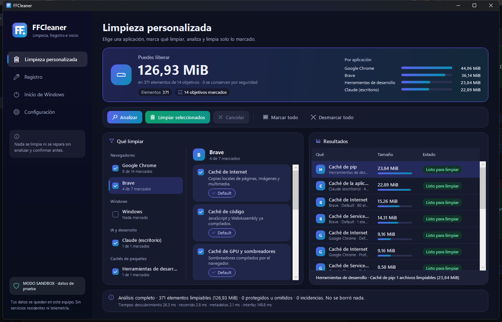
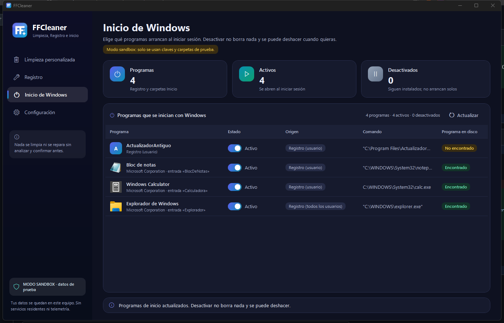

# FFCleaner

**Limpiador para Windows 10/11 que solo borra lo que tú marcas, con respaldo antes de tocar nada.**
*A Windows 10/11 cleaner that only deletes what you select, with a backup before changing anything (UI in Spanish and English).*

Aplicación de escritorio en C# WPF / .NET 10, sin servicios residentes, sin telemetría y sin dependencias externas.





<sub>Capturas con datos de demostración, generadas con `python tools/readme_screenshots.py`.</sub>

## Funciones

- **Limpieza personalizada**:
  - Eliges una aplicación, marcas sus categorías y perfiles, analizas y ves cuánto puedes liberar, en total y por aplicación.
  - Después limpias solo lo marcado. Nada se borra al analizar.
  - Muestra también lo liberado en total desde que usas FFCleaner.
  - Navegadores Chrome, Brave, Edge, Chromium y Vivaldi: caché de Internet, de código, de GPU y de Service Workers, por perfil. También historial, descargas, cookies, sesiones y formularios.
  - Firefox: caché, historial y cookies.
  - Windows: temporales, miniaturas, informes de errores y volcados; con administrador, también los temporales del sistema, los registros de Windows y Optimización de distribución.
  - Herramientas de IA y desarrollo: Claude, Claude Code, Cursor, VS Code, Codex, Copilot, LM Studio, Ollama y Hugging Face.
  - NVIDIA y cachés de pip, npm y uv.
- **Registro**:
  - Detecta referencias a programas que ya no existen.
  - Cada hallazgo se clasifica por riesgo y solo los «Seguro» se pueden reparar.
  - Antes de reparar guarda un respaldo verificado, que se puede restaurar.
- **Inicio de Windows**: activa o desactiva lo que arranca con Windows, con el nombre y el icono reales de cada programa. Es reversible y no borra nada.
- **Configuración**: tema claro, oscuro o el de Windows; español o inglés; actualizaciones automáticas; conexión de agentes de IA.
- **Agentes de IA (MCP)**: `FFCleaner.Mcp.exe` permite que un agente de programación (Claude Code, Codex, Cursor…) libere espacio o repare el Registro con las mismas protecciones que la aplicación.

## Seguridad: qué nunca hace

- Nunca borra nada sin analizar antes y sin tu confirmación. Cambiar una casilla invalida el análisis anterior.
- Nunca toca contraseñas, marcadores, tarjetas ni direcciones guardadas.
- Los datos personales del navegador y los modelos de IA solo se borran si los marcas uno a uno. Exigen el navegador cerrado.
  - Antes de tocar una base se guarda una copia temporal. Si todo sale bien, la copia también se borra, para que lo borrado no quede guardado en FFCleaner.
  - Solo se conserva si no se pudo comprobar que la base quedó bien, junto a un aviso `CONSERVAR.txt`.
- No sigue enlaces ni accesos directos. Conserva los archivos en uso, de solo lectura, compartidos por enlaces físicos o que cambiaron desde el análisis.
- En el Registro solo repara lo clasificado como «Seguro», siempre con un respaldo verificado antes; restaurar nunca sobrescribe datos que cambiaron.
- No promete que limpiar el Registro acelere el equipo.

## Instalar

Descarga `FFCleaner-<versión>-Setup.exe` desde [Releases](../../releases):

- Instala solo para tu usuario y no pide administrador.
- Se desinstala desde «Aplicaciones instaladas» de Windows y conserva tus datos salvo que pidas borrarlos.
- Existe también el ZIP portable, que no necesita instalarse.

Ninguno de los dos necesita .NET instalado, porque incluyen su propio runtime. El ejecutable no está firmado, así que Windows SmartScreen puede avisar la primera vez.

**Actualizaciones**:

- Al abrirse, la copia instalada busca versiones nuevas en las releases de este repositorio, **antes de mostrar su ventana**.
- Si hay una versión nueva, aparece una ventana «Actualizando FFCleaner» con el progreso: descarga, comprobación de huellas SHA-256 e instalación. Luego se abre la versión nueva, que muestra «FFCleaner se actualizó a la versión X».
- Como todo ocurre antes de abrir la aplicación, nunca coincide con un análisis, una limpieza o una reparación.
- Mientras FFCleaner está abierto no se reinicia nunca: «Buscar ahora» (en Configuración) solo avisa y la instalación queda para la próxima vez que lo abras.
- No se actualiza en estos casos, y queda para la próxima vez:
  - si hay otra ventana de FFCleaner abierta;
  - si un agente está usando su servidor MCP;
  - si se abrió como administrador.
- La versión nueva se copia y se comprueba aparte y luego sustituye a la instalada. Si algo falla, la instalada sigue intacta y esa versión no se reintenta hasta pasadas 24 horas.
- Se puede desactivar en Configuración. Si no hay conexión, la comprobación se abandona a los pocos segundos y FFCleaner se abre normalmente.
- La única conexión es con la API de GitHub; no se envía ningún dato tuyo.

## Agentes de IA (MCP)

```
claude mcp add ffcleaner -- "%LOCALAPPDATA%\Programs\FFCleaner\FFCleaner.Mcp.exe"
```

Configuración > Agentes de IA copia este comando o el bloque JSON con la ruta real.

Herramientas:

- `list_cleanup_targets`, `analyze_cleanup` y `clean`.
- `scan_registry` y `repair_registry`.
- `list_registry_backups` y `restore_registry_backup`.
- `list_startup_programs` y `set_startup_program`.

Reglas que aplica el propio servidor:

- **Limpiar**: `clean` exige el `analysis_id` de un análisis previo (un solo uso, caduca a los 15 minutos) y `confirm=true`.
- **Datos personales y modelos**: requieren `allow_personal_data` y `allow_models`, respectivamente.
- **Registro**: solo se reparan hallazgos «Seguro», con respaldo previo.
- **Permiso del usuario**: los parámetros anteriores los pone el propio agente. Por eso, borrar datos personales o modelos y reparar o restaurar el Registro exigen además que actives ese permiso en Configuración > Agentes de IA. Viene desactivado.
- **Rutas protegidas**: el servidor respeta las exclusiones guardadas en los ajustes, igual que la aplicación.

## Compilar y probar

Requisitos: Windows 10/11 x64, [SDK de .NET 10](https://dotnet.microsoft.com/download) y Python 3. Si existe `../.tools/dotnet10`, los scripts usan ese SDK portátil; si no, el `dotnet` del sistema.

```
python tools/verify_release.py               # compila y ejecuta todas las pruebas
python tools/build_portable.py --replace     # paquete portable + instalador en dist/
python tools/verify_release.py --portable    # además: paquete, instalador y actualización automática
python tools/make_strings.py                 # regenera los textos en español e inglés
```

Las pruebas que borran o modifican algo trabajan **solo** en sandbox:

- Carpetas `%TEMP%\ffcleaner-sandbox-*`, que llevan un archivo marcador.
- La clave `HKCU\Software\CleanerApp_TestSandbox`.
- La aplicación, el servidor MCP y el instalador aceptan parámetros de sandbox para probarse sin tocar datos reales.

| Proyecto | Responsabilidad |
|---|---|
| `src/FFCleaner.Core` | Catálogo y descubrimiento, modelo de selección, flujo de análisis, guardas, datos de navegador (SQLite de Windows), ajustes |
| `src/FFCleaner.Cleaning` | Borrado por handle con revalidación por archivo, bitácora y total acumulado |
| `src/RegistryAnalysis` | Detectores del Registro, riesgo, respaldo verificado, reparación, restauración y programas de inicio |
| `src/FFCleaner.Desktop` | Interfaz WPF (temas en `Themes/`, textos en `Strings/`) y actualizador |
| `src/FFCleaner.Mcp` | Servidor MCP por stdio |
| `src/FFCleaner.Setup` | Asistente de instalación, actualización y desinstalación |
| `src/FFCleaner.Cli` | Diagnóstico de solo lectura |

## Publicar una versión

1. Cambia `<Version>` en `Directory.Build.props`.
2. Comprueba la privacidad: `python tools/check_public.py`. Falla si algún archivo contiene tu usuario, rutas de tu equipo o correos.
3. Haz el commit, crea la etiqueta y súbela: `git tag v0.4.0` y `git push origin main v0.4.0`.
4. El flujo `.github/workflows/release.yml` compila, prueba y publica el instalador, el ZIP y sus huellas SHA-256. Las versiones así publicadas ya saben buscar sus actualizaciones en este repositorio.

## Datos de la aplicación

Están en `%LOCALAPPDATA%\FFCleaner`:

- `settings.json`: ajustes.
- `totals.json`: total liberado.
- `Journal\`: bitácoras de limpieza.
- `RegistryBackups\`: respaldos del Registro.
- `BrowserBackups\`: copias temporales de las bases del navegador (solo quedan si una restauración no se pudo comprobar).
- `Logs\ffcleaner.log`: registro de diagnóstico.

## Límites conocidos

- La reparación de HKLM solo se ha probado en sandbox; en el Registro real requiere abrir FFCleaner como administrador.
- La limpieza no pasa por la Papelera y el tamaño indicado es el lógico.
- Las evidencias técnicas del Registro y algunos mensajes internos siguen en español aunque la interfaz esté en inglés.

## Licencia

[MIT](LICENSE).
